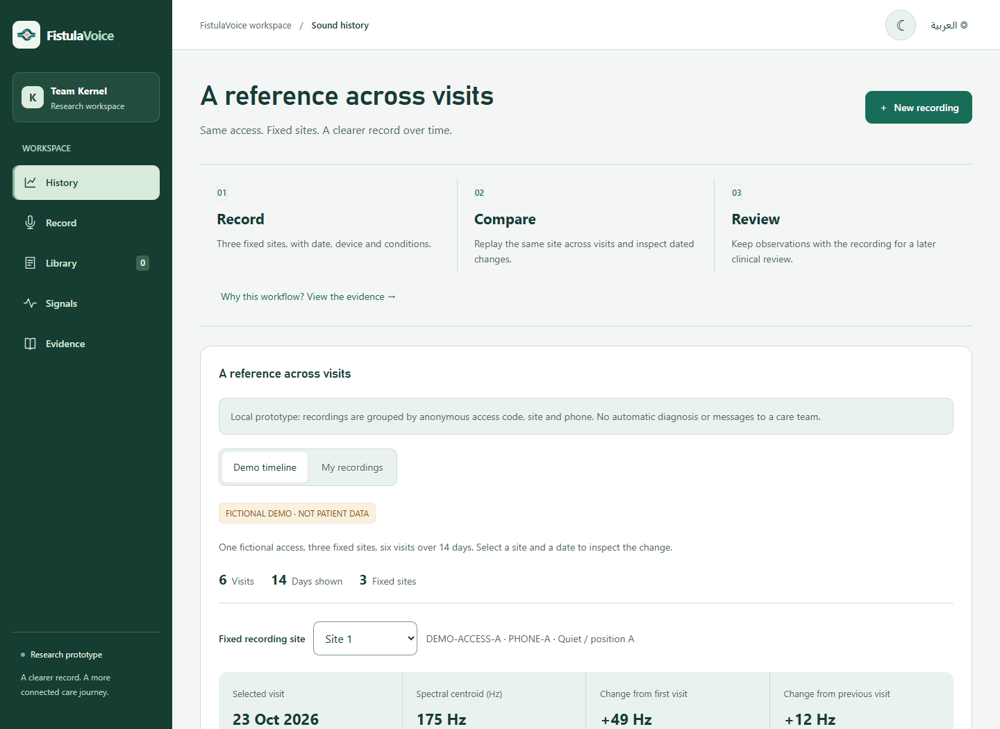

# FistulaVoice

### A consistent sound history for dialysis access care

**Team Kernel · MEDATHON prototype**

[Live prototype](https://fistulavoice.vercel.app/) · [Reviewer walkthrough](docs/REVIEWER-GUIDE.md) · [Research data](docs/RESEARCH-DATA.md) · [Technical guide](docs/TECHNICAL-GUIDE.md)

FistulaVoice adds a structured, replayable sound history to the assessment of arteriovenous fistulas used for hemodialysis. Its proposed value is continuity: a previous recording remains available for comparison across visits and care-team members.

The working prototype demonstrates **Record → Compare → Review** through guided capture, dated histories, compatible-recording playback and local review notes. External research signals and cited studies distinguish the scientific rationale from the product's current capabilities.

> **Status:** functional research prototype, not a validated diagnostic device. Measurements describe audio, not stenosis severity or blood flow. Secure multi-user sharing and predictive detection are future work; recordings currently stay in the user's browser.



## Try it in three minutes

No account or installation is needed to explore the [live demo](https://fistulavoice.vercel.app/).

1. **History:** select a site and date. Explore six fictional visits over 14 days. Values are labeled as fictional, not patient observations.
2. **Signals:** play a research recording. The waveform follows the audio; pause, seek or freeze the visualization. Case labels come from dataset examinations, not app predictions.
3. **Record:** enter an anonymous access code and device code, choose a fixed site, and record a non-medical test sound for up to 20 seconds. This step requires microphone permission.
4. **History → My recordings:** repeat with matching metadata to compare current and previous recordings. Save a local review note.
5. **Evidence:** inspect the original studies, their findings and the remaining validation needs.

See the [reviewer guide](docs/REVIEWER-GUIDE.md) for a complete demonstration route.

## Problem and proposed contribution

Written descriptions may not preserve the original sound heard during an earlier assessment. FistulaVoice proposes a fistula-focused reference organized by **anonymous access code, fixed recording site, date, device and recording conditions**.

The first recording is a reference, not a verified healthy baseline. Comparisons remain within compatible contexts. Whether this workflow improves clinical review or handover still needs testing with dialysis teams.

## What works today

- **Dated history:** site selection, a chronological chart, and differences from first/previous visits.
- **Browser recording:** up to 20 seconds per selected site, with required anonymous access/device codes.
- **Compatible comparisons:** matching access, site, device, condition and decoded sample rate; legacy samples without placement metadata are excluded.
- **Playback and review:** original audio, synchronized waveforms, current/previous recording comparison and local review notes.
- **Technical analysis:** duration, RMS, digital peak, near-limit samples, dominant frequency, spectral centroid and spectral similarity.
- **Research examples:** FiSaV PZT recordings, spectrograms, raw sensor traces and source-supplied examination findings.
- **Local controls:** download recordings, export measurements as CSV and delete captures.
- **Interface:** English/Arabic, RTL, responsive navigation, light/dark themes, keyboard focus and reduced-motion support.

## Three types of data, kept distinct

**Fictional timeline:** invented values demonstrate changes at three fixed sites. They do not represent clinical progression and have no fabricated patient audio attached.

**External research recordings:** derived FiSaV sensor excerpts from two different participants. They are not phone recordings, repeated visits or a before/after treatment comparison. Clinical labels come from the source. Playback gain differs between participants, so absolute listening levels should not be compared.

**Your captures:** microphone recordings made in your browser. They receive no disease label and are not automatically uploaded to a care team.

## Research behind the direction

- **Song et al., Scientific Reports (2023):** recordings from 40 patients using dedicated acoustic equipment. The study reported sensitivity, specificity and accuracy above 90% for detecting stenosis greater than 50% in its dataset. These are **external results**, not FistulaVoice results. [Study](https://pubmed.ncbi.nlm.nih.gov/37848465/)
- **Poloni et al., Annals of Biomedical Engineering (2025):** six patients followed prospectively with electronic-stethoscope recordings and hemodynamic measurements. Supports studying longitudinal acoustic changes, not assuming this app's centroid metric is clinically validated. [Study](https://pubmed.ncbi.nlm.nih.gov/39485642/)
- **Higuchi et al. (2023):** phone recordings before/after angioplasty in three patients provide initial feasibility observations, not reliable performance across all phones or home conditions. [Study](https://www.jstage.jst.go.jp/article/jsdt/56/3/56_117/_article/-char/en)

The three-site, approximately 20-second setup is a consultation-informed pilot choice, not a validated clinical standard derived from these papers.

### Next validation priorities

1. Compare smartphone and electronic-stethoscope recordings.
2. Test repeatability at consistent sites under controlled conditions.
3. Evaluate usefulness for review/handover and the additional workload.
4. With consent and approvals, link longitudinal recordings to ultrasound findings and clinical outcomes for future detection research.

## Current boundaries

The prototype does not diagnose stenosis, predict an imminent clot, estimate access flow, recommend treatment or provide continuous emergency monitoring. It does not replace examination, Doppler ultrasound or dedicated flow measurement. There is no trained diagnostic model, hardware integration, live clinician notification service or secure multi-user patient portal in this release.

## Run locally

Static HTML, CSS and JavaScript: **no npm install or build step required.**

```bash
git clone https://github.com/iamghaid/FistulaVoice.git
cd FistulaVoice
python -m http.server 8000 --directory dist
```

Open [localhost:8000](http://localhost:8000). Microphone access requires HTTPS or localhost and support for MediaRecorder, Web Audio and IndexedDB. Opening `index.html` directly is not supported.

### Included checks

With Node.js installed, run from the repository root:

```bash
node check-signals.cjs
node check-history.cjs
```

Checks cover signal calculations, WAV consistency, translation keys, comparison isolation and timeline calculations. Browser checks also exercised playback synchronization, seeking, local review flows, responsive layouts and themes. They do not establish clinical validity or universal device compatibility.

## Repository map

```text
dist/                    Deployable static application
  app.js                 Recording, storage, library and exports
  measurements.js        Technical signal analysis
  history-*.js           Timeline, comparison rules and labels
  history.js             Real capture history and review notes
  playback-wave.js       Audio-synchronized visualization
  research.js            External FiSaV cases and plots
  evidence.js            Research rationale and links
  interface.js / .css    Navigation and visual system
  assets/                Logo, fonts and research excerpts
docs/
  REVIEWER-GUIDE.md      Walkthrough and submission checklist
  TECHNICAL-GUIDE.md     Analysis, storage and deployment
  RESEARCH-DATA.md       FiSaV provenance and processing
  CHANGELOG.md           Release summary
  LOGO-PROMPT.md         Logo provenance
  images/               Prototype screenshots
tools/fisav/             Optional data-preparation scripts
check-signals.cjs        Signal and language checks
check-history.cjs        Comparison and history checks
```

## Privacy and storage

Captures, metadata and review notes stay in IndexedDB in the current browser/origin. Theme preference is stored locally. There is no application backend uploading recordings. Changing devices/browsers or clearing site storage makes local records unavailable; download anything you need to keep first.

Use anonymous codes, not patient identifiers. Start demonstrations with non-medical sounds. Patient recording requires consent and a clinician-agreed capture method. Browser-local storage is not a production clinical-record system or an assurance of healthcare compliance.

## Team and ownership

**Team Kernel** — roles from the submitted presentation:

- **Gheid Abdulkarim** — Computer Science; Team Leader & Researcher. [GitHub](https://github.com/iamghaid) · [LinkedIn](https://www.linkedin.com/in/gheid-abdulkarim-6567872ab/)
- **Idris Jan** — Software Engineering; MVP Developer.
- **Alaa Ammar** — Medical Student; Medical Research & Clinical Input.

Repository maintained under **iamghaid**.

## Attribution and licensing

- **FiSaV-derived recordings:** CC BY 4.0. Dataset authors, transformations and source links are documented in [Research data](docs/RESEARCH-DATA.md). The [original license](dist/assets/research/LICENSE_CC_BY.txt) is retained.
- **Fonts:** the supplied [font license](dist/assets/fonts/LICENSE.pdf) is retained.
- **Logo:** generation provenance is documented in [Logo notes](docs/LOGO-PROMPT.md).
- **Application code:** no open-source license has been granted. Repository visibility does not extend asset licenses to the application code.

**Live prototype:** [fistulavoice.vercel.app](https://fistulavoice.vercel.app/) · **Repository:** [iamghaid/FistulaVoice](https://github.com/iamghaid/FistulaVoice)
