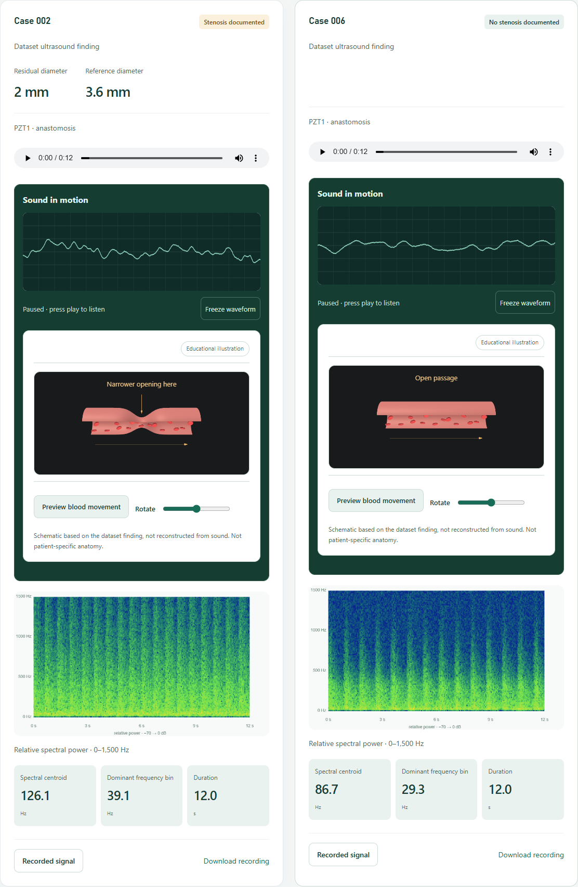

<p align="center">
  
</p>

<h1 align="center">FistulaVoice</h1>
<p align="center">A consistent sound history for dialysis access care<br>سجل صوتي موحّد لمتابعة وصلة الغسيل الكلوي</p>
<p align="center"><strong>Team Kernel · Interactive research prototype</strong></p>
<p align="center"><a href="https://fistulavoice.vercel.app/">Open the prototype</a> · <a href="#english">English</a> · <a href="#العربية">العربية</a> · <a href="docs/REVIEWER-GUIDE.md">Reviewer guide</a></p>

## English

FistulaVoice is a working prototype for recording, replaying and comparing arteriovenous fistula sounds across visits. It organizes recordings by anonymous access code, recording site, date, device and conditions, so a previous observation remains available for review.

**Current focus:** consistent documentation and comparison. The prototype does **not** diagnose stenosis, recognize whether an arbitrary sound is a fistula, or issue clinical alerts. Predictive detection is future research.

### Try the prototype

No account or installation is required. [Open FistulaVoice](https://fistulavoice.vercel.app/).

1. **History:** compare dates and sites in the labeled fictional timeline.
2. **Signals:** listen to two external research recordings and view their waveforms. The case findings come from the source dataset.
3. **Record:** enter an anonymous access code and device code, select a site, and capture a non-medical test sound for up to 20 seconds. Allow microphone access.
4. **History → My recordings:** repeat with matching metadata, replay compatible recordings and save a local review note.
5. **Library / Evidence:** inspect measurements, download recordings, or read the research sources.

Microphone permission is needed only for recording. Captures and notes stay in the current browser; they are not sent to a clinician or shared with other users.

### What is implemented

- Guided microphone recording and browser-local storage.
- Dated, site-specific histories and current/previous recording playback.
- Audio measurements, synchronized waveforms and CSV export.
- Local review notes and recording deletion/download.
- Research examples with source-provided findings and spectrograms.
- Educational 3D vessels with clearly identified illustrative movement.
- English/Arabic interface, light/dark themes and responsive layouts.

### What the demonstration data means

| Data | Purpose | Limitation |
| --- | --- | --- |
| Fictional timeline | Demonstrate dated comparisons | Invented values, not observed disease progression |
| FiSaV research excerpts | Listen to examples with documented findings | Two different participants; not phone recordings or before/after visits |
| Your microphone captures | Try capture, storage and comparison | No automatic disease label or clinical alert |

The 3D vessel is a schematic, not a reconstruction from audio. In research examples its appearance follows the dataset finding. During microphone capture, sound can affect the visualization but cannot establish narrowing or blood flow. Recordings have been processed for listening; absolute volume across research cases is not clinically comparable.

### Research and next steps

The [research data guide](docs/RESEARCH-DATA.md) records dataset provenance, processing and attribution. The in-app **Evidence** page links to studies and explains their limitations. Published results belong to those studies, not this prototype.

Next steps are to test capture consistency, compare phone recordings with dedicated acoustic equipment, and evaluate the usefulness of the workflow with dialysis teams. Hardware integration, secure team sharing and a validated predictive model are not included in this release.

## العربية

**FistulaVoice** نموذج أولي لتسجيل صوت الناسور الشرياني الوريدي المستخدم للغسيل الكلوي، وحفظه والاستماع إليه ومقارنته عبر الزيارات. تُرتّب التسجيلات حسب رمز وصلة مجهول الهوية، وموضع التسجيل، والتاريخ، والجهاز وظروف الالتقاط، لتوفير مرجع يمكن العودة إليه.

**الهدف الحالي هو توحيد التوثيق والمقارنة.** النموذج لا يشخّص التضيق، ولا يتأكد أن أي صوت مُدخل هو صوت ناسور، ولا يصدر إنذارات طبية. التنبؤ هدف بحثي لاحق.

### تجربة النموذج

افتح [الموقع](https://fistulavoice.vercel.app/) دون تسجيل حساب، ويمكن تغيير اللغة من أعلى الصفحة.

1. **السجل:** جرّب المقارنة بين التواريخ والمواضع في البيانات الوهمية المعلّمة بوضوح.
2. **الإشارات:** استمع إلى عينتين بحثيتين وشاهد الموجة الصوتية. التصنيف مأخوذ من فحوص المصدر، وليس نتيجة تشخيص التطبيق.
3. **التسجيل:** أدخل رمزًا مجهول الهوية ورمز الجهاز، واختر الموضع، ثم سجّل صوتًا تجريبيًا غير طبي لمدة تصل إلى 20 ثانية بعد السماح بالميكروفون.
4. **السجل ← تسجيلاتي:** كرّر التسجيل بالبيانات نفسها لمقارنة التسجيلات المتوافقة، وأضف ملاحظة مراجعة محلية.
5. **المكتبة / الأدلة:** راجع القياسات أو نزّل التسجيلات أو افتح المصادر البحثية.

التسجيلات والملاحظات محفوظة في المتصفح الحالي فقط. لا تُرسل تلقائيًا إلى فريق طبي، ولا تنتقل بين الأجهزة. حذف بيانات الموقع قد يزيل السجل المحلي.

### كيف نقرأ النتائج؟

- **السجل التجريبي:** أرقام وهمية لشرح المقارنة، وليست تطورًا سريريًا حقيقيًا.
- **العينات البحثية:** تسجيلات حساسات من مشاركين مختلفين، وليست تسجيلات هاتف أو مقارنة قبل العلاج وبعده.
- **تسجيلات المستخدم:** صوت فعلي مع خصائص تقنية؛ دون تصنيف مرضي أو إنذار طبي.
- **الثري دي:** رسم تعليمي؛ ليس شكل ناسور المريض المستنتج من الصوت. في الأمثلة البحثية يتبع تصنيف المصدر.

الخطوات القادمة هي اختبار ثبات التسجيل وجودته، ومقارنة الهاتف بمعدات تسجيل مخصصة، ودراسة فائدة السجل للفريق الطبي. لا يتضمن هذا الإصدار جهازًا متصلًا، أو مشاركة آمنة بين المستخدمين، أو نموذج تنبؤ مُثبتًا.

## Run locally · التشغيل المحلي

Static HTML, CSS and JavaScript. No build step, API key or package installation is required.

```bash
git clone https://github.com/iamghaid/FistulaVoice.git
cd FistulaVoice
python -m http.server 8000 --directory dist
```

Open **http://localhost:8000**. Recording requires HTTPS or localhost and a browser supporting MediaRecorder, Web Audio and IndexedDB. Do not open the HTML file directly.

Run the included checks with Node.js:

```bash
node check-signals.cjs
node check-history.cjs
```

These check signal calculations and comparison rules, not clinical performance.

## Files · دليل الملفات

| Path | Contents / المحتوى |
| --- | --- |
| `dist/` | Deployable website / ملفات الموقع الجاهزة للنشر |
| `dist/app.js` | Capture, storage, library and exports / التسجيل والحفظ والمكتبة والتصدير |
| `dist/measurements.js` | Audio calculations / حساب الخصائص الصوتية |
| `dist/history.js` | Saved history and review notes / السجل والملاحظات |
| `dist/history-protocol.js` | Recording compatibility rules / شروط توافق التسجيلات |
| `dist/history-demo.js`, `history-chart.js` | Fictional timeline and chart / بيانات العرض والرسم الزمني |
| `dist/visit-comparison.js` | Previous/current visit summary / ملخص مقارنة زيارتين |
| `dist/playback-wave.js` | Waveform during playback / الموجة المتزامنة مع الصوت |
| `dist/flow-scene.js` | Educational 3D vessel / الرسم التعليمي ثلاثي الأبعاد |
| `dist/research.js`, `evidence.js` | Research examples and evidence / العينات والأدلة البحثية |
| `dist/layout.css`, `interface-overrides.css` | Layout and final visual adjustments / التخطيط والتنسيق النهائي |
| `dist/concise-copy.js` | Concise interface text / النصوص المختصرة للواجهة |
| `dist/assets/` | Logo, fonts, licensed library and research samples / الأصول والعينات |
| `docs/` | Reviewer, technical and data guides / أدلة المراجعة والتقنية والبيانات |
| `tools/fisav/` | Optional research-data preparation / تجهيز البيانات البحثية |
| `check-signals.cjs`, `check-history.cjs` | Automated checks / اختبارات برمجية |

[Submission notes](docs/SUBMISSION-NOTES.md) · [Technical guide](docs/TECHNICAL-GUIDE.md) · [Data provenance](docs/RESEARCH-DATA.md) · [Reviewer walkthrough](docs/REVIEWER-GUIDE.md)

## Team · الفريق

**Team Kernel**

- **Gheid Abdulkarim** — Computer Science · Team Leader & Researcher.
- **Idris Jan** — Software Engineering · MVP Developer.
- **Alaa Ammar** — Medical Student · Medical Research & Clinical Input.

Maintained by [iamghaid](https://github.com/iamghaid).

## Privacy and attribution · الخصوصية ونسب المصادر

Use anonymous codes and non-medical sounds for demonstrations. Patient recording requires consent and a clinician-agreed method. This browser-local prototype is not a production patient-record system and does not replace clinical assessment.

- **FiSaV excerpts:** CC BY 4.0; authors, source links and transformations are in [RESEARCH-DATA.md](docs/RESEARCH-DATA.md). [License](dist/assets/research/LICENSE_CC_BY.txt).
- **Three.js 0.160.1:** [MIT license](dist/assets/vendor/THREE-LICENSE.txt). Vessel geometry is created in code; no paid 3D asset is included.
- **Fonts:** [included license](dist/assets/fonts/LICENSE.pdf).
- **Logo:** [provenance](docs/LOGO-PROMPT.md).
- **Application code:** no open-source license grant. Public visibility does not grant rights beyond the applicable licenses.

<details>
<summary>Research comparison screenshot · صورة المقارنة البحثية</summary>



</details>
